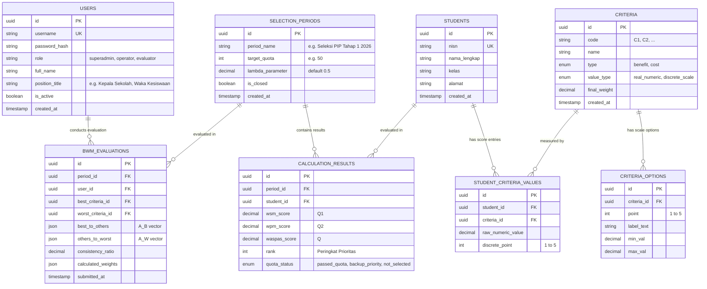

# Product Requirements Document (PRD) [Revisi]
## Sistem Pendukung Keputusan Seleksi Penerimaan Program Indonesia Pintar (PIP)
### Metode: Integrasi Multi-Expert BWM (Geometric Mean) & WASPAS

---

## 1. Dokumen Kontrol & Ringkasan Eksekutif

| Parameter | Detail |
| :--- | :--- |
| **Judul Proyek** | Sistem Pendukung Keputusan Seleksi Penerimaan Bantuan PIP |
| **Metode Pembobotan** | Multi-Decision Maker Best-Worst Method (BWM) + Geometric Mean Aggregation |
| **Metode Perangkingan** | Weighted Aggregated Sum Product Assessment (WASPAS) |
| **Target Pengguna** | Internal Sekolah: **Superadmin / Operator Sekolah** dan **Tim Pengambil Keputusan (Verifikator)** |
| **Output Utama** | **Rangking Prioritas Kelayakan** dan **Alokasi Pemenuhan Kuota Penerima Bantuan** |
| **Karakteristik Data** | Alternatif > 100 siswa, kriteria campuran (Cost & Benefit, Riil & Kualitatif 1-5) |

### 1.1 Latar Belakang & Masalah
Penetapan siswa penerima Program Indonesia Pintar (PIP) di tingkat satuan pendidikan menghadapi beberapa tantangan utama:
1. **Keterbatasan Kuota Bantuan:** Kuota alokasi penerima bantuan dari dinas/pemerintah terbatas (misal: hanya tersedia untuk 50 atau 75 siswa dari total ratusan pendaftar/calon). Sistem wajib menghasilkan **perangkingan prioritas absolut** yang jelas untuk memastikan kuota terisi tepat sasaran.
2. **Subjektivitas Pengambil Keputusan:** Pembobotan kriteria melibatkan beberapa pihak internal (Kepala Sekolah, Wakil Kesiswaan, Operator PIP). Diperlukan metode BWM yang teruji konsistensinya serta diagregasi menggunakan Rata-rata Geometrik.
3. **Skala Alternatif Besar (>100 Siswa):** Membutuhkan mekanisme import massal yang cepat dengan validasi data otomatis untuk mencegah anomali atau salah input.
4. **Karakter Kriteria Beragam:** Penanganan kriteria bertipe *Cost* (semakin kecil semakin prioritas) dan *Benefit* (semakin besar semakin prioritas), baik berupa nilai riil maupun skala diskret 1–5.
5. **Antarmuka Internal yang Bersih & Mudah:** Sistem difokuskan sepenuhnya untuk kebutuhan operasional internal sekolah. Pengguna tidak dibebani istilah teknis matematis yang rumit, disajikan dengan antarmuka bersih, elegan, dan bebas dari elemen visual berlebihan (*zero UI slop, no emojis*).

---

## 2. Aktor & Matriks Hak Akses (Internal RBAC)

Sistem dirancang khusus untuk operasional **internal sekolah** (tanpa portal publik / user umum / siswa):

| Fitur / Modul | Superadmin / Operator Sekolah | Tim Pengambil Keputusan (Verifikator / Pakar) |
| :--- | :---: | :---: |
| **Manajemen Pengguna & Penilai** | Full Access (CRUD akun internal) | View Profile Sendiri |
| **CRUD Kriteria & Skala Sub-kriteria** | Full Access (CRUD) | View Only |
| **Kuesioner Pembobotan BWM** | Monitoring Status Pengisian Pakar | Input Evaluasi BWM Mandiri (Skala 1–9) |
| **Agregasi Bobot (Geometric Mean)** | Eksekusi & Kunci Bobot Periode | View Hasil Bobot Gabungan |
| **Manajemen Data Siswa (CRUD + Import Excel)** | Full Access (Import massal >100 siswa) | View Data Siswa |
| **Konfigurasi Kuota & Eksekusi WASPAS** | Set Kuota, Hitung & Terbitkan Peringkat | View Perangkingan & Detail Skor |
| **Laporan & Ekspor Berita Acara (PDF/Excel)** | Download Full Report & Audit Trail | Download Dokumen Rekomendasi |

---

## 3. Logika Perangkingan Prioritas & Pemenuhan Kuota

### 3.1 Mekanisme Kuota & Klasifikasi Status Siswa
Sistem memiliki parameter dinamis: **Kuota Penerima ($K$)** pada setiap periode seleksi.

Setelah nilai preferensi gabungan WASPAS ($Q_i$) dihitung, alternatif diurutkan secara menurun (*descending*):
$$Q_{(1)} \ge Q_{(2)} \ge \dots \ge Q_{(m)}$$

Sistem mengelompokkan siswa ke dalam kategori fungsional:
1. **Prioritas Utama (Lolos Kuota):**
   - Siswa pada urutan peringkat $1 \le \text{Rank} \le K$.
   - Keterangan: *"Direkomendasikan Menerima PIP (Memenuhi Kuota)"*.
2. **Prioritas Pengganti (Cadangan):**
   - Siswa pada urutan peringkat $K+1 \le \text{Rank} \le K + \text{Margin Cadangan}$ (misal: 10–20 siswa berikutnya).
   - Keterangan: *"Cadangan Prioritas X"* (secara otomatis menjadi kandidat pengganti jika ada siswa penerima utama yang pindah, mengundurkan diri, atau gugur verifikasi faktual).
3. **Tidak Lolos Seleksi:**
   - Siswa di luar batas kuota dan batas cadangan.

### 3.2 Ringkasan Metrik Dashboard Alokasi Kuota
Dashboard menyajikan kartu ringkasan instan untuk operator:
- **Total Pendaftar Terproses:** $m$ siswa.
- **Kapasitas Kuota:** $K$ siswa.
- **Tingkat Pemenuhan Kuota:** $\frac{\min(m, K)}{K} \times 100\%$.
- **Ambang Batas Nilai Kelayakan Minimum (*Cut-off Score*):** Nilai $Q$ dari siswa pada peringkat ke-$K$.

---

## 4. Landasan Matematis Sistem

### 4.1 Kriteria: Cost & Benefit serta Standarisasi Nilai
Setiap kriteria $C_j$ ($j = 1, 2, \dots, n$) memiliki konfigurasi:
1. **Tipe Kriteria:**
   - **Benefit:** Nilai lebih tinggi lebih diprioritaskan menerima PIP.
   - **Cost:** Nilai lebih rendah lebih diprioritaskan menerima PIP.
2. **Bentuk Nilai:**
   - **Nilai Riil (Numerik):** Langsung diolah sesuai besaran aslinya (misal: Penghasilan = Rp 800.000).
   - **Kategori / Non-Numerik (Skala 1–5):**
     - Pada kriteria **Benefit**: Kategori paling layak/prioritas diberi nilai **5**, paling tidak prioritas diberi nilai **1**.
     - Pada kriteria **Cost**: Kategori yang paling membutuhkan/prioritas utama (misal: kondisi rumah paling memprihatinkan/daya paling minim) disesuaikan agar bernilai terkecil **1** (sesuai kaidah perhitungan cost).

---

### 4.2 Multi-Decision Maker Best-Worst Method (BWM)

Sistem mendukung $P$ orang pengambil keputusan. Setiap penilai $p \in \{1, \dots, P\}$:
1. Memilih kriteria terbaik $C_B$ dan terburuk $C_W$.
2. Membentuk vektor *Best-to-Others* $A_B = (a_{B1}, \dots, a_{Bn})$ dengan skala 1–9.
3. Membentuk vektor *Others-to-Worst* $A_W = (a_{1W}, \dots, a_{nW})^T$ dengan skala 1–9.
4. Menyelesaikan pemrograman linear BWM:
   $$\min \xi^L$$
   $$\text{s.t.} \quad |w_B^{(p)} - a_{Bj} w_j^{(p)}| \le \xi^L, \quad |w_j^{(p)} - a_{jW} w_W^{(p)}| \le \xi^L, \quad \sum_{j=1}^n w_j^{(p)} = 1, \quad w_j^{(p)} \ge 0$$
5. Verifikasi konsistensi: $\text{CR}^{(p)} = \frac{\xi^*}{\text{CI}} < 0.10$.

#### Agregasi Rata-rata Geometrik (*Geometric Mean*)
Bobot konsisten dari seluruh $P$ penilai digabungkan:
$$w_j^{G} = \left( \prod_{p=1}^P w_j^{(p)} \right)^{1/P}$$

Normalisasi bobot konsensus akhir:
$$\bar{w}_j = \frac{w_j^{G}}{\sum_{m=1}^n w_m^{G}}, \quad \sum_{j=1}^n \bar{w}_j = 1$$

---

### 4.3 Perangkingan WASPAS (Weighted Aggregated Sum Product Assessment)

Dari matriks keputusan $X = [x_{ij}]_{m \times n}$ ($m > 100$ siswa):

1. **Normalisasi Kriteria:**
   - Benefit: $r_{ij} = \frac{x_{ij}}{\max_k x_{kj}}$
   - Cost: $r_{ij} = \frac{\min_k x_{kj}}{x_{ij}}$
2. **Model Aditif (WSM):**
   $$Q_i^{(1)} = \sum_{j=1}^n r_{ij} \bar{w}_j$$
3. **Model Multiplikatif (WPM):**
   $$Q_i^{(2)} = \prod_{j=1}^n (r_{ij})^{\bar{w}_j}$$
4. **Preferensi Gabungan WASPAS:**
   $$Q_i = \lambda Q_i^{(1)} + (1 - \lambda) Q_i^{(2)} \quad (\text{default } \lambda = 0.5)$$
5. **Penentuan Peringkat Prioritas:**
   Mengurutkan alternatif berdasarkan nilai $Q_i$ tertinggi ke terendah, lalu mencocokkannya secara otomatis terhadap kuota $K$.

---

## 5. Fitur & Spesifikasi Fungsional

### 5.1 Modul Manajemen Kriteria & Sub-kriteria
- CRUD Kriteria (Kode, Nama, Jenis: Benefit/Cost, Tipe Nilai: Riil/Skala 1–5).
- Pengaturan rentang/opsi sub-kriteria untuk kriteria berskala 1–5 dengan panduan penentuan point yang jelas.
- Validasi data input agar kriteria Cost tidak menerima nilai $\le 0$.

### 5.2 Modul Penilaian BWM (Multi-Penilai)
- Akun verifikator/penilai dapat login dan mengisi kuesioner komparasi.
- Antarmuka berbentuk *wizard* interaktif dengan bahasa yang lugas (misal: "Seberapa penting Kriteria Terbaik dibandingkan Kriteria Lainnya?").
- Sistem langsung mendeteksi nilai CR secara *real-time*. Jika $CR \ge 0.10$, sistem memandu penilai untuk menyeimbangkan penilaiannya.
- Modul Agregasi: Tombol sekali klik untuk menghitung *Geometric Mean* bobot gabungan dan menguncinya untuk periode seleksi berjalan.

### 5.3 Modul Data Siswa & Import Massal Excel (>100 Siswa)
- **Unduh Template:** File `.xlsx` terstruktur yang otomatis menyesuaikan kolom dengan kriteria aktif saat ini.
- **Mesin Validasi Pra-Impor:**
  - Menolak upload jika ada header kriteria yang hilang.
  - Memeriksa keabsahan format: NISN unik, tipe angka pada kolom riil, dan angka 1–5 pada kolom skala.
  - Menampilkan panel pratinjau error: menampilkan nomor baris dan deskripsi ketidaksesuaian data secara spesifik.
  - Data valid dapat langsung dikonfirmasi masuk ke database sekaligus.

### 5.4 Modul Eksekusi Perhitungan & Simulasi Kuota
- **Kalkulasi Cepat:** Menghitung ratusan siswa secara asinkron tanpa membebani browser (< 1 detik).
- **Simulasi Kuota Interaktif:**
  - Operator memasukkan angka Kuota (contoh: 50).
  - Tabel perangkingan secara instan menampilkan pembatas visual antara peringkat 1–50 (Lolos Kuota) dan peringkat 51 ke atas (Cadangan Prioritas).
  - Operator dapat mengubah nilai kuota untuk melihat simulasi skenario penetapan baru tanpa perlu menghitung ulang dari awal.
- **Tab Transparansi:** Menyediakan tab untuk melihat matriks normalisasi, nilai WSM, dan nilai WPM bagi keperluan verifikasi teknis/sidang.

### 5.5 Modul Cetak & Ekspor Dokumen
- **Ekspor Dokumen Berita Acara (PDF):** Mencantumkan daftar siswa lolos kuota, daftar cadangan prioritas, tandatangan tim penilai, dan ringkasan bobot kriteria.
- **Ekspor Detail Nilai (Excel):** Berisi seluruh rincian nilai mentah, nilai normalisasi, skor $Q$, dan status akhir untuk arsip kearsipan sekolah.

---

## 6. Standar UI/UX (Clean, Enterprise, Zero UI Slop)

1. **Estetika Antarmuka:**
   - Desain profesional bergaya *enterprise dashboard*.
   - **Bebas dari emotikon**: Semua indikator status murni menggunakan teks tegas dan ikon SVG clean berstandar industri (Lucide Icons).
   - Palet warna fokus pada fungsi: Slate/Navy `#0F172A` (latar utama), Indigo `#4F46E5` (aksi utama), Emerald `#059669` (indikator lolos kuota), Amber `#D97706` (cadangan prioritas).
2. **Kenyamanan Orang Awam:**
   - Alur kerja sistem dirangkum dalam alur 4 langkah (*Workflow Bar*):
     `1. Kriteria & Bobot Pakar` $\rightarrow$ `2. Data Siswa & Import` $\rightarrow$ `3. Perhitungan WASPAS` $\rightarrow$ `4. Penetapan Kuota & Laporan`.
   - Tidak ada formula rumit yang ditampilkan di halaman utama operator; detail matematis diletakkan rapi di dalam tab audit/transparansi bagi pihak yang membutuhkan verifikasi ilmiah.

---

## 7. Skema Database Relasional

---

## 8. Penanganan Kondisi Khusus & Validasi Sistem

1. **Skor $Q$ Sama / Peringkat Seri di Ambang Kuota:**
   - Jika siswa di peringkat batas kuota (misal posisi 50 dan 51) memiliki nilai preferensi $Q$ yang identik, sistem menerapkan aturan prioritas sekunder (*tie-breaker*): memprioritaskan siswa dengan nilai tertinggi pada kriteria yang memiliki bobot terpenting ($C_{\max}$).
2. **Kriteria Cost Bernilai 0:**
   - Validasi input menolak angka $\le 0$ untuk kriteria Cost guna menjamin normalisasi pecahan dan perpangkatan WPM tidak menghasilkan nilai tak hingga (*infinity / division by zero*).
3. **Fleksibilitas Kuota Berjalan:**
   - Pengubahan angka kuota secara dinamis langsung mengalokasikan ulang label status penerima tanpa perlu mengulang impor data ataupun kalkulasi ulang matriks.
